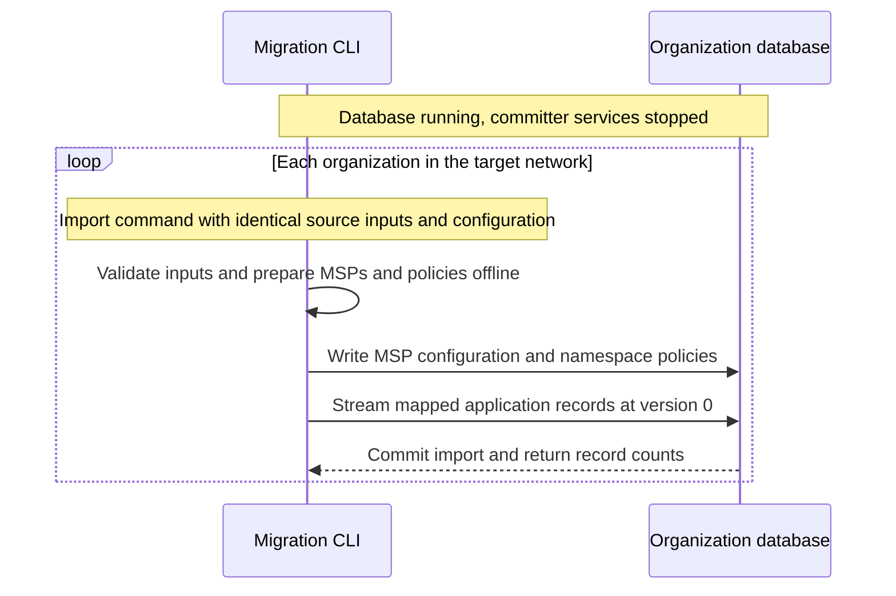

- Feature Name: fabric_classic_snapshot_migration_to_fabric_x
- Start Date: 2026-08-04
- RFC PR: -
- Fabric-X Component: Fabric peer snapshot, Fabric-X committer database
- Fabric-X Issue: https://github.com/LF-Decentralized-Trust-Mentorships/mentorship-program/issues/65

# Summary
[summary]: #summary

This RFC defines an offline migration from Fabric peer snapshots into each
organization's Fabric-X committer database. A standalone Go CLI reuses source
MSPs and chaincode policies, applies mappings supplied by administrators, and
streams public key/value records and private-data hashes directly into the
target database. Every imported application key starts at Fabric-X version `0`.

Each organization runs the tool independently against its running database
with committer services stopped. All runs for a target network use identical
source snapshots, mappings, and target configuration. Operators compare database
record counts and confirm membership and namespace policies before starting
services and enabling application traffic.

The tool prepares membership and namespace policies offline, so operators do
not need to start a Fabric-X network to create namespaces before importing.
The CLI reads snapshots directly, without an intermediate bundle or separate
exporter. It does not track intermediate migration states or require committer
code changes.

# Scope
[scope]: #scope

This RFC covers input validation, reuse of MSPs and policies, offline target
setup, and merging source channels into a target network. It also covers loading
public state and private-data hashes at version `0`, verifying each database,
and switching applications to Fabric-X.

Copying block history, transaction IDs, or private values is out of scope, as
are automatic chaincode translation and online or incremental migration.

# Motivation
[motivation]: #motivation

Fabric-X has a different runtime, network model, and application programming
model from Fabric Classic. Moving current application state requires explicit
namespace mappings and authorization rules for the target network.

A [Fabric peer snapshot](https://hyperledger-fabric.readthedocs.io/en/latest/peer_ledger_snapshot.html)
contains public state and private-data hashes, but not the complete blockchain
or private collection values. Reading this format lets the migration tool
preserve application state without depending on the source database engine.
It also lets administrators consolidate several source channels into one
Fabric-X network.

Fabric remains the source of truth until operators verify the target and
switch application traffic to Fabric-X.

# Guide-level explanation
[guide-level-explanation]: #guide-level-explanation

## Terms

* **Source checkpoint:** the last Fabric block represented by a snapshot.
  Each source channel has its own agreed checkpoint.
* **Namespace mapping:** an explicit mapping from a source channel and
  namespace to a target network and namespace.
* **Target database:** one organization's committer database in a target
  Fabric-X network.
* **Target key version:** the Fabric-X version assigned to an imported
  application key. Every imported key starts at version `0`.

Source checkpoints are not Fabric-X block heights. The CLI does not copy or
store source key versions.

## Manual operator steps

1. Stop new writes and wait for pending transactions to finish on all selected
   source channels. Capture the agreed snapshots and save the channel
   configuration in effect at each checkpoint.
2. Agree on namespace mappings, membership, and target policies with the
   participating organizations. Prepare the target network configuration using
   the procedure under [Target configuration](#target-configuration).
3. Keep committer services and other target database writers stopped. The
   databases remain running. The target must not have accepted any application
   transactions before import.
4. Run the CLI independently for each organization's database, using identical
   source snapshots, mappings, and network configuration for that target.
5. Compare database record counts across organizations. Confirm that membership
   and namespace policies match the agreed target configuration.
6. Once every organization's results match, start Fabric-X services, check
   application reads and authorization, and enable application traffic.

For an existing but unused target deployment, stop its services before import
and check its configuration against the agreed configuration. For a new
deployment, prepare configuration offline and start services after verification.
Neither path requires namespace-creation transactions before loading state.

The CLI needs these inputs:

* the source snapshots and channel configuration at their checkpoints;
* mappings from source channels and namespaces to target networks and namespaces;
* the target network settings needed alongside the reused MSPs and policies; and
* connection details for the organization's target database.

A single-channel migration needs one snapshot and its channel configuration.
Provide additional snapshots only when importing additional channels. The
[usage examples](#cli-and-mapping-examples) illustrate a proposed command and
mapping format.

pgx supports the standard PostgreSQL password file through `PGPASSFILE`.
Operators can use it to keep the password out of command arguments.

## Automated flow

The CLI reads the source snapshots and configuration, validates mappings and
policies, and streams mapped public records and private-data hashes into the
database. Operators then verify the results as described in manual step 5.



## Component responsibilities

| Component | Responsibility |
| --- | --- |
| Fabric peer | Produce official snapshots and provide source channel configuration |
| Standalone migration CLI | Validate inputs, reuse MSPs and policies, map and stream records, write one organization's database, and report counts |

## Imported and excluded data

The migration imports current public keys and values, private-data hashes, and
the membership and namespace policies prepared from the agreed source inputs.
The CLI preserves public key and value bytes and imports private-data hashes
as Fabric-X application state.

Fabric blocks, transaction envelopes, transaction IDs, historical key values,
source key versions, private values, and chaincode packages are not migrated.
The CLI reads source lifecycle and collection configuration to prepare policies.
It does not copy that configuration as application state or history.

## Block history and application state

A channel's blocks contain ordered transactions. The state database contains
current key/value records produced by those transactions. Hash records are
part of that state, not extra transactions between public records.

```text
Fabric channel history                 Snapshot at the checkpoint

Block 10: asset1 = blue                 Public state:
Block 11: asset1 = red       ------->     asset1 -> red
          private owner update         Private-data hashes:
                                         H(owner_key) -> H(owner_value)
                                                |
                                                | direct import
                                                v
                                       Fabric-X namespace: assets_basic

                                       key             value           version
                                       asset1          red             0
                                       H(owner_key)    H(owner_value)   0
```

`H(...)` represents existing hash bytes, not a new key encoding. Private keys
and values are not copied. With `target_hash_namespace` set, the hash row goes
to that namespace instead.

The import neither copies nor reorders the source transactions. Database rows
have no transaction order. New Fabric-X transactions use the imported state
as their starting point and follow normal Fabric-X ordering and validation.

## Channel consolidation

Channel consolidation means importing state from several source channels into
one Fabric-X network. Each source namespace can keep a separate target
namespace, as shown in the [usage examples](#cli-and-mapping-examples).

Combining public namespaces is a separate choice. For example, `assets/basic`
and `securities/basic` can both map to `network1/basic` if their keys do not
overlap and their effective endorsement policies are the same. The tool rejects
duplicate target keys and conflicting policies.

The participating organizations choose who joins the target network before
migration. The source channels no longer have separate network memberships
in that target.

## CLI and mapping examples

These examples describe the proposed interface. Each mapping file names one
target network, so the command does not need a separate target-network flag.
Each organization uses the same mapping and source inputs with its own database
connection. Use the normal Fabric-X configuration format for `network1.config`.
The examples are alternative migrations, each starting with empty target
application namespaces.

### One source channel

Import public state and any private-data hashes from `assets/basic` into
`network1/assets_basic`. Omitting `target_hash_namespace` puts both kinds of
records in that namespace, subject to key and policy collision checks.

`single-channel.json`:

```json
{
  "target_network": "network1",
  "mappings": [
    {
      "source_channel": "assets",
      "source_namespace": "basic",
      "target_namespace": "assets_basic"
    }
  ]
}
```

```sh
PGPASSFILE=./postgres.pass \
fabric-x-migrate import \
  --snapshot assets=./snapshots/assets \
  --source-config assets=./config/assets.block \
  --mapping single-channel.json \
  --target-config ./config/network1.config \
  --database-url 'postgres://migration@db.org1.example:5432/committer?sslmode=verify-full'
```

### Two channels with separate target namespaces

Import both channels into `network1`, keeping `assets/basic` and
`securities/basic` in separate namespaces. Their keys can overlap because they
have different destinations. This example also imports hashes from the
`owners` collection in `assets/basic`, placing the hashes in `assets_hashes`
through the optional `target_hash_namespace` field.

`separate-namespaces.json`:

```json
{
  "target_network": "network1",
  "mappings": [
    {
      "source_channel": "assets",
      "source_namespace": "basic",
      "target_namespace": "assets_basic",
      "target_hash_namespace": "assets_hashes"
    },
    {
      "source_channel": "securities",
      "source_namespace": "basic",
      "target_namespace": "securities_basic"
    }
  ]
}
```

```sh
PGPASSFILE=./postgres.pass \
fabric-x-migrate import \
  --snapshot assets=./snapshots/assets \
  --source-config assets=./config/assets.block \
  --snapshot securities=./snapshots/securities \
  --source-config securities=./config/securities.block \
  --mapping separate-namespaces.json \
  --target-config ./config/network1.config \
  --database-url 'postgres://migration@db.org1.example:5432/committer?sslmode=verify-full'
```

### Two channels sharing a target namespace

Use the same source inputs as the previous example, but send both public
namespaces to `network1/basic`. Here `target_hash_namespace` is omitted, so
hashes also go to `basic`. All imported records must have distinct target keys
and compatible endorsement policies. If both sources contain `asset1`, for
example, the tool rejects the import.

`shared-namespace.json`:

```json
{
  "target_network": "network1",
  "mappings": [
    {
      "source_channel": "assets",
      "source_namespace": "basic",
      "target_namespace": "basic"
    },
    {
      "source_channel": "securities",
      "source_namespace": "basic",
      "target_namespace": "basic"
    }
  ]
}
```

```sh
PGPASSFILE=./postgres.pass \
fabric-x-migrate import \
  --snapshot assets=./snapshots/assets \
  --source-config assets=./config/assets.block \
  --snapshot securities=./snapshots/securities \
  --source-config securities=./config/securities.block \
  --mapping shared-namespace.json \
  --target-config ./config/network1.config \
  --database-url 'postgres://migration@db.org1.example:5432/committer?sslmode=verify-full'
```

# Reference-level explanation
[reference-level-explanation]: #reference-level-explanation

## Invariants

1. Source writes stop before the agreed snapshots are captured.
2. Every organization in a target network uses identical source snapshots,
   mappings, and target network configuration.
3. Input and policy validation completes before a database write transaction
   begins.
4. Target databases remain running; committer services and other writers remain
   stopped through import and verification.
5. Every mapped application namespace is empty before import.
6. Every imported public or private-hash key has target version `0`.
7. Records are mapped while streaming, with bounded memory use.
8. Record counts are obtained from the target database.
9. Failed imports leave no partial database changes.
10. Imported rows are not represented as Fabric-X transactions or block history.

## Source validation

The CLI checks the snapshot metadata, channel, and checkpoint. It rejects
unsupported state database types. It checks that the file list matches the
metadata, each entry is a regular file within the snapshot directory, and each
file matches its declared SHA-256 hash. It also checks the additional metadata
hash against the exact signable metadata bytes.

The CLI reads every public and private-data hash record. It rejects malformed
records, invalid record order, and unread bytes at the end of a data file.

The CLI first validates records and policies without loading the entire state
into memory. It then reads the records again during import and rechecks file
hashes before committing. If an input changes, the import rolls back. The
configuration and mappings must also remain unchanged during the run.

The operator supplies the channel configuration in effect at each snapshot
checkpoint because the snapshot does not include the full configuration. Use
trusted source channel records to confirm that the configuration belongs to
that channel and checkpoint. Snapshot file hashes alone cannot prove that the
configuration or source peer is trusted.

## Namespace mapping

Administrators supply mappings that identify each source channel and namespace
and its target network and namespace. The CLI includes hash records from every
collection in each selected source namespace.

Each source mapping may include `target_hash_namespace`:

* If omitted, import public records and hashes into `target_namespace`.
* If supplied, import public records into `target_namespace` and all hashes
  from that source namespace into `target_hash_namespace` in the same network.

This option selects a normal Fabric-X application namespace. It does not create
private collections or restrict which network members receive the hashes.
Key collision and policy compatibility checks apply to both destinations.
Separating hashes from public records does not resolve duplicate keys between
source collections that still share the hash destination.

Each run selects one target network and writes one organization's
database. The CLI validates the complete mapping and imports the entries for
that network. The mapping contains no organization-specific database addresses
or snapshot paths.

The CLI rejects missing source channels or namespaces and invalid or reserved
target namespace IDs. Each source channel/namespace pair can appear only once
in the mapping. Multiple public source namespaces may map to the same
`(target network, target namespace)` when their effective
endorsement policies are the same.

A record collision means that two source records map to the same target
network, namespace, and key. The CLI rejects these collisions even if the
values match; it never overwrites a record to resolve them.

The CLI skips unmapped application namespaces. It reads system namespaces such
as `_lifecycle` to obtain policies. These system
namespaces cannot be mapped to target application namespaces.

## Target configuration

Operators provide the target network identity, ordering configuration, and
administrative policies in manual step 2. The CLI then prepares the target
configuration without starting Fabric-X services:

1. Reuse the MSP definitions from each source channel's checkpoint
   configuration. Preserve MSP IDs and public verification material. Reject
   conflicting definitions of the same MSP ID when consolidating channels.
   Organization signing keys are not migration inputs.
2. Use each selected chaincode's committed endorsement policy as its target
   namespace policy. Resolve references to channel policies using the original
   source channel configuration and membership, preserving who must endorse
   and how many endorsements are required. Sources sharing a target namespace
   must resolve to the same effective policy. Reject conflicting policies.
3. For hash records, use the collection endorsement policy when specified,
   otherwise the chaincode policy. All records sharing a target namespace must
   have the same effective endorsement policy. Reject conflicting policies,
   unsupported validation plugins, and key-level overrides that cannot be
   preserved. Perform these checks before writing to the database.
4. Validate the resulting MSP configuration and namespace policies, then write
   them to the committer database using Fabric-X's standard formats. Existing
   target entries must match; missing entries can be created. Prepare matching
   service startup configuration offline.

Starting Fabric-X must preserve the imported state and use the stored
membership and policies. No network startup or namespace-creation transactions
are required before import.

## Private-data hashes

Import private-data hashes as Fabric-X application state. Private values remain
excluded. Imported hash records start at version `0` and are included in database
record counts.

## Database write

After validating inputs, the CLI connects to the selected organization's
PostgreSQL or YugabyteDB database and imports the data in one transaction.
It prevents concurrent imports, creates missing namespace tables using the
committer's schema, checks that mapped application namespaces are empty, and
writes the agreed MSP configuration and namespace policies.

The CLI then maps records as it reads the source streams and inserts bounded
batches into the target namespace tables. All imported public and hash records
use version `0`; source versions are discarded. Configuration and policy
records use the same initial format and versions as normal Fabric-X setup.

Before committing, the CLI checks each target namespace's row count against
the total parsed record count from all sources mapped to it. Invalid input,
an input change, a collision, or a database error rolls back all changes made
by the run. After committing, the CLI reports the source channels, checkpoints,
snapshot identities, mappings, and database record counts. This output is a
report. The tool does not store a separate migration state record.

## Verification and cutover

Verification covers all imported public state and private-data hashes.
Operators compare:

* source snapshot identities and checkpoints;
* the agreed mappings and target membership and policies; and
* database record counts for every mapped namespace.

Compare organizations within each target network. Different target networks can
intentionally contain different state. Do not start services or switch
application traffic if results differ. If import output is lost, read the counts
from the database without importing again.

> **Note:** Fabric-X will introduce a database digest verification feature outside
> this RFC. Once available, it can help verify that organizations imported the
> same state.

After verification, start Fabric-X services and confirm they read the imported
state and enforce the stored policies. Enable application traffic only
after these checks pass.

## Repeated imports and recovery

A failed database transaction rolls back and can be retried with the same
inputs. A committed import cannot be repeated over non-empty application
namespaces. To rebuild the target, start with an empty database and import the
saved snapshots, configuration, and mappings. The tool cannot import only the
changes since a previous run or resume a partial import.

Fabric-X block history does not contain the imported rows. Save the source
inputs and back up each target database before accepting production writes.
Repeating the import restores only the state at migration. Later Fabric-X
changes require normal Fabric-X backup and recovery procedures. Before target
traffic begins, a failed cutover can return to Fabric. Once Fabric-X accepts
production writes, restoring only the source snapshot would lose those writes.

## Chaincode and application migration

Classic chaincode does not move unchanged. Applications must adapt their reads
and writes to Fabric-X APIs and their mapped namespaces, retain business-rule
tests, and replace chaincode events and history queries where needed.
Application changes are separate from the CLI. Before accepting the migration,
check application behavior and authorization against the imported state.

# Drawbacks
[drawbacks]: #drawbacks

* Cutover requires downtime for snapshot capture, validation, import, and
  comparison across organizations.
* The CLI must stay compatible with the committer's database schema and
  configuration formats.
* Importing a large state in one transaction can use substantial database
  resources even though CLI memory use is bounded.
* Consolidation changes which organizations share a network and requires their
  agreement on membership and governance.
* If Fabric-X cannot enforce a source policy, operators must resolve the
  difference before migrating the affected namespaces.
* The target has no Fabric history or private values. Restoring imported state
  requires a database backup or the saved migration inputs.

# Rationale and alternatives
[alternatives]: #rationale-and-alternatives

## Intermediate migration bundle (Rejected)

A `.fxgenesis` bundle, USTAR container, manifest, and exporter/importer split
would add another representation of the source data. The CLI reads the official
snapshots and maps records while streaming directly into the target database.

## Start the target network to create namespaces (Not needed)

The CLI writes MSP configuration and namespace policies to the committer
database while services are stopped. Services start after data loading and
verification.

## Custom database credential handling (Not needed)

pgx supports `PGPASSFILE`; a custom credential flag or file format is unnecessary.

## Copy Fabric database files (Rejected)

Fabric and Fabric-X use different storage models. Reading snapshots preserves
application bytes without copying LevelDB or CouchDB files.

## Recreate historical application transactions (Rejected)

A snapshot contains current state, not the complete history needed to recreate
the source ledger. Imported records start at version `0`.

## Migrate transaction IDs (Not needed)

Source transaction IDs are not required in Fabric-X target state.

## Online dual-write or incremental migration (Not needed)

This proposal uses an offline snapshot cutover. Coordinating writes across both
platforms would require a separate migration design.

# Prior art
[prior-art]: #prior-art

The [Ledger Checkpointing RFC](https://github.com/hyperledger/fabric-rfcs/blob/main/text/0000-ledger-checkpointing.md) defines Fabric peer
snapshots for using current state without historical blocks.

The [Fabric-X RFC](https://github.com/hyperledger/fabric-rfcs/blob/main/text/0000-fabric-x-next-generation.md) describes its microservice
architecture and identifies snapshot migration as a possible path.

The [Fabric Ecosystem Coexistence Model](https://github.com/hyperledger/fabric-rfcs/blob/main/text/0000-fabric-coexistence-model.md)
describes compatibility between Fabric implementations.

# Testing
[testing]: #testing

Validate the complete migration with independent organization databases,
including channel consolidation and private-data hashes. Identical inputs must
produce matching imported state and record counts. After startup,
applications must read the imported state and enforce the reused policies.
Invalid inputs or failed imports must leave no partial database changes.

# Proof of concept
[proof-of-concept]: #proof-of-concept

[fabric-x-migrate-poc](https://github.com/syndbg/fabric-x-migrate-poc).

# Dependencies
[dependencies]: #dependencies

* Fabric peer snapshot generation and supported snapshot formats.
* Source channel configuration and committed chaincode and collection policy
  information in effect at each checkpoint.
* The committer's database schema, configuration formats, and existing MSP and
  policy validation mechanisms.
* PostgreSQL or YugabyteDB access to each organization's target database.
* Agreed target network configuration and applications adapted to Fabric-X.
